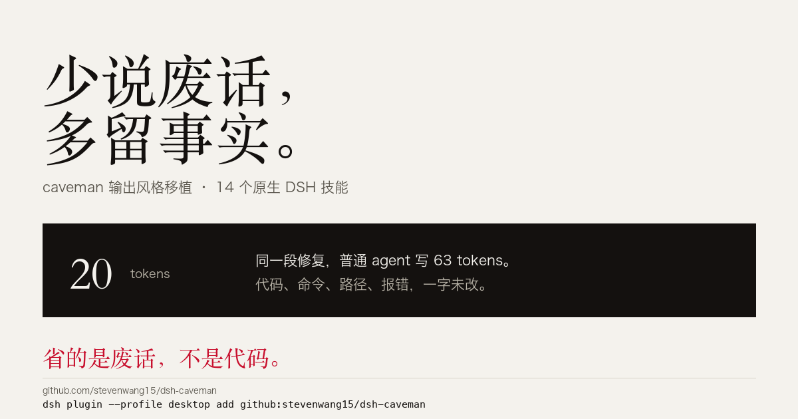

# dsh-caveman

**让 DSH 里的 agent 少说废话、多留事实。** 这是 [JuliusBrussee/caveman](https://github.com/JuliusBrussee/caveman) 的 DeepSeek Harness 非官方移植：14 个原生 DSH 技能，输入 `/caveman` 就能用。

上游那句话是 **"why many token when few do trick"**：同一句修复，普通 agent 写 63 token，caveman 写 20 token，代码、命令、路径、报错字符一个不改。

> **许可证：Apache-2.0。** 上游 3.0.0 起统一采用 Apache-2.0（根目录 `LICENSE-MIT` 仅用于保留 3.0.0 之前 MIT 部分的历史贡献声明）。改造与分发需随包带 `LICENSE`、保留 `NOTICE`、声明修改——本包逐条做到了，见 [NOTICE](NOTICE) 与下文「Apache-2.0 要求与逐条落实」。
>
> **非官方移植。** "Caveman" 是 Julius Brussee 的商标，本包与上游作者无隶属或背书关系，仅以指称方式（nominative use）说明移植来源。



### 一行安装

```bash
dsh plugin --profile desktop add github:stevenwang15/dsh-caveman
```

需要 Node 22+。完整装法、参数与卸载见下文。

---

## 装了什么（14 个技能，三组）

### 1. 语气组（output，8 个）

| 技能 | 触发 | 做什么 |
| --- | --- | --- |
| `caveman` | `/caveman` | 主语气：先给答案，去掉客套与总结，技术事实全留 |
| `ultracave` | `/ultracave` · `/caveman ultra` | 极限压缩：片段化、能一个词就一个词（仅用户可调用） |
| `megacave` | `/megacave` · `/caveman wenyan` | 文言文语气，字数更少，术语原样（仅用户可调用） |
| `caveman-commit` | `/caveman-commit` | Conventional Commits：祈使句、≤50 字符、不写 AI 署名 |
| `caveman-review` | `/caveman-review` | 一行一条评审：`L42: bug: user 可能为 null。加 guard。` |
| `caveman-help` | `/caveman-help` | 命令速查卡 |
| `caveman-stats` | `/caveman-stats` | 诚实报用量：指向宿主用量视图，明说省了多少没测过 |
| `caveman-compress` | `/caveman-compress <路径>` | 把 AGENTS.md / CLAUDE.md / todo 压成 caveman 体，省输入 token |

### 2. 压缩组的安全设计（`caveman-compress` 是改造过的）

上游用 Python CLI 把文件**发给外部模型端点**。DSH 里有模型在跑，所以本移植去掉了外发：

- **不外发**：当前会话的模型就地压缩，不调 `claude` CLI、不调 API、不读 key；
- **备份在源目录之外**：`.caveman/backups/<相对路径>.original.md`——`AGENTS.md.original.md` 放在旁边会被 agent 当成活指令再读一遍；
- **覆盖前过闸**：`skills/caveman-compress/scripts/verify-compress.mjs` 校验代码块/行内代码逐字未变、标题未丢、URL/环境变量/否定词未丢、文件确实变小，任一条不过就还原；
- **先拒绝**：`.env`、`credentials*`、`*.key`、`*.pem`、`id_rsa*` 等敏感文件名**读都不读**直接拒绝；只压 `.md/.txt/.typ/.typst/.tex` 和数字后缀文本，不碰代码文件；
- **只报字节，不报节省**：字节不是 token，宿主没有对照测量。

### 3. native 工作流纪律组（6 个，仅提示词）

| 技能 | 用在什么时候 |
| --- | --- |
| `investigate-first` | 原因不明的故障：先证据后结论，没找到机制不改代码 |
| `lean-build` | 容易过度设计的新功能：先复用、守住范围、写明停止条件 |
| `migration` | schema/数据/API/协议/配置/依赖迁移：先映射读写方与兼容窗口，证明可回滚 |
| `safe-refactor` | 重构但要行为不变：用验证夹住结构改动 |
| `surgical-patch` | 小 bug 修在最窄的负责层，带回归证明 |
| `verify-and-stop` | 只验证不扩范围：跑门禁、给证据、停 |

这 6 个共享上游 `native-core.md`（构建最简完整系统的那段默认），插件在加载时把它追加到每个技能正文后面。

## 和上游的差异（诚实降级，不假装）

| 上游有 | DSH 没有 | 本插件的处理 |
| --- | --- | --- |
| hook 写标志文件实现跨轮模式持久 | 无 hooks | 模式只在会话内保持；模型不读写任何 mode 文件 |
| statusline / `Caveman mode:` 注入 | 无 statusline | status 回答带 `(not tracked by this host)` |
| 任务分类器决定 native 技能何时生效 | 无分类器 | 注册为模型可调用技能，按 description 匹配，偏离时说明 |
| transcript 计数算节省 | 无该数据 | 明说 savings unknown，不编数字 |
| CLI/proxy/engine/MCP（省输入 token） | 未移植 | 见下 |

**没移植**（依赖上游 Go 运行时或 subagent preset）：`cavecrew`（要 cavecrew-* 三个 preset）、`caveman-discover/explore/learn/manage/optimize/setup/evidence-review`（要 Caveman CLI 与本地实验数据）、以及 CLI/proxy/engine/MCP/shrink。

## 安装（从 GitHub 装，不需要 npm）

`dsh-caveman` 这个名字在 npm 上已被另一个作者的同名插件占用，因此本包**不发布 npm**，GitHub 就是分发渠道。DSH 的插件安装本来就接受 `file:` / git / URL 三种 spec，下面三种方式任选。

### 方式 A：一行脚本（推荐）

```bash
curl -fsSL -o /tmp/dsh-caveman-install.sh \
  https://raw.githubusercontent.com/stevenwang15/dsh-caveman/main/scripts/install-from-github.sh
bash /tmp/dsh-caveman-install.sh desktop     # 默认 profile 是 desktop
```

脚本会：下载对应 release 的 tgz → 备份 profile 的 `package.json`/`cordis.patch.yml`/`pnpm-lock.yaml` → `pnpm add file:<tgz>` → 把 `dsh-caveman` 加进 `dsh.profile.bundles` → 触发一次配置变更让运行中的 DSH 重载。指定版本：`bash /tmp/dsh-caveman-install.sh desktop 0.2.2`。

### 方式 B：直接从 git 仓库装

```bash
PROFILE=~/.dsh/profiles/desktop
NODE=~/.dsh/dsh-runtimes/dsh-primary-runtime/dependencies/node/bin/node
PNPM=~/.dsh/dsh-runtimes/dsh-primary-runtime/dependencies/pnpm/bin/pnpm.mjs

cd "$PROFILE"
"$NODE" "$PNPM" add "github:stevenwang15/dsh-caveman" --config.confirmModulesPurge=false
# 再把 "dsh-caveman" 加进 package.json 的 dsh.profile.bundles
```

DSH 的 pnpm 会从 GitHub 拉源码（本机实测约 3 分钟，无需 token），装出来的内容和 release 一致。缺点是每次更新要重跑一次 `pnpm add`。

### 方式 C：克隆仓库后本地装

```bash
git clone --depth 1 https://github.com/stevenwang15/dsh-caveman.git /tmp/dsh-caveman
/tmp/dsh-caveman/scripts/install-local.sh desktop
```

`install-local.sh` 没有现成 tgz 时会自己 `npm pack`（npm 缓存不可写时自动换到临时目录），然后走同一套备份 → `pnpm add` → 加 bundle → 触发热重载的流程。

### 卸载

```bash
# 方式 A 装的最省事：
./scripts/uninstall-local.sh desktop
```

装完**不用重启**：DSH 的 HMR 会在 profile 配置变化时重排组合并重新加载 bundle。实测发现**只改 package.json 的 bundle 列表不会重载模块**（宿主仍持有旧实例），改 `cordis.patch.yml` 才会——安装脚本和 `scripts/dev-reload.sh` 都会刷新一行可删除的标记注释来触发。卸载脚本会恢复安装时备份的三个文件，并移除 `node_modules/dsh-caveman`。

## 验证（已完成，可复跑）

```bash
npm test        # 三组一起跑
```

| 测试 | 断言什么 | 结果 |
| --- | --- | --- |
| `test/smoke.mjs` | 14 个技能注册、描述 ≤500 字符、resourceBase 真实目录、归因在正文、native-core 只进 native 组、compress 闸门与备份路径、不承诺宿主没有的能力 | **155/155** |
| `test/dsh-contract.mjs` | 从**已安装 App 的 app.asar** 里取出 `dsh-skill` 的真实 `validateRuntimeSkill`/`validateDefinition` 源码并执行，验证每个定义能过当前版本的加载期校验 | **30/30** |
| `test/compress-gate.mjs` | 安全压缩放行；改代码块/丢标题/丢 URL/丢否定词/丢环境变量/没变小，全部拒绝 | **9/9** |

**真机验证**：装进 desktop profile 后，当前会话的技能目录直接多出 `caveman`/`caveman-commit`/`caveman-help`/`caveman-review`/`caveman-stats` 等（`ultracave`/`megacave` 按 `modelInvocable:false` 对模型隐藏，只在用户输入时出现），`skill("caveman")` 返回的正文与 resourceBase 指向安装目录——说明注册、注入、资源基地址三条链路都通。

## Apache-2.0 要求与逐条落实

Apache-2.0 的关键义务，逐条对应到本包：

| 条款 | 要求 | 本包做法 |
| --- | --- | --- |
| §4(a) | 随分发给接收方一份 License | `LICENSE` = Apache-2.0 全文 |
| §4(b) | 修改过的文件要显著声明改动 | `NOTICE` 的 "State changes" 逐条列出；`caveman-compress/SKILL.md` 头部注释标明 ADAPTED；`index.js` 头部说明是新增文件与追加说明 |
| §4(c) | 保留源作品的版权/专利/商标/归属声明 | 每个技能的正文末尾带 `Ported from JuliusBrussee/caveman (Apache-2.0)`，`NOTICE` 含上游版权行 |
| §4(d) | 源作品有 NOTICE 时，须附上与被衍生作品相关的归属声明 | 上游 NOTICE **逐字**收录在 `NOTICE` 的 "Upstream NOTICE" 段，本包的声明追加在其后 |
| §6 | 不授予商标权 | `NOTICE` 与 README 明确写商标归属与非官方关系，名称仅作指称 |
| §3/§5 | 专利授权与贡献条款自动生效 | 无需额外动作 |
| 无二进制 | 上游 Go 运行时的第三方许可文本义务 | 本包只分发技能文本，不分发任何 Go 二进制，故不适用；`NOTICE` 中已说明 |

**一句话**：可以用、可以改、可以发，但**不能不带 LICENSE/NOTICE**、**不能把改动说成上游原样**、**不能暗示官方**。本包这三点都守住了。

## 目录

```
dsh-caveman/
├── index.js                     # 注册 14 个技能 + 按组追加 DSH runtime 说明（新增文件）
├── cordis.patch.yml             # bundle layer
├── skills/
│   ├── <name>/SKILL.md          # 上游正文逐字复制（Apache-2.0）
│   ├── caveman-compress/SKILL.md          # 唯一改造文件（头部已标明 ADAPTED）
│   ├── caveman-compress/scripts/verify-compress.mjs  # 压缩闸门
│   └── native-core.md           # 上游 native 组共享默认（逐字）
├── scripts/install-from-github.sh  # 从 GitHub release 直装（含热重载）
├── scripts/install-local.sh / uninstall-local.sh
├── test/smoke.mjs · dsh-contract.mjs · compress-gate.mjs
├── LICENSE  # Apache-2.0 全文
├── NOTICE   # 上游 NOTICE 逐字 + 本移植的修改与商标声明
└── package.json  # 固定上游 version/commit，便于重新同步
```

**同步上游**：把 `skills/<name>/SKILL.md` 与 `skills/native-core.md` 用上游同路径文件覆盖；`caveman-compress` 例外（改造过，需人工合并）。`index.js` 不用改，DSH 说明自动追加。上游 commit 记在 `package.json` 的 `caveman.upstreamCommit`。

## DSH 插件家族

| 插件 | 一句话 |
| :--- | :--- |
| [dsh-caveman](https://github.com/stevenwang15/dsh-caveman) | 让 agent 少说废话、多留事实 |
| [dsh-taste-skill](https://github.com/stevenwang15/dsh-taste-skill) | 前端设计：先定方向，再量，再看 |
| [dsh-session-workspace](https://github.com/stevenwang15/dsh-session-workspace) | 一个对话，一个独立工作区 |

---

遇到问题或想加功能，请[开 issue](https://github.com/stevenwang15/dsh-caveman/issues/new/choose)。如果这个插件帮到你，给个 ⭐ 能让更多人找到它。
